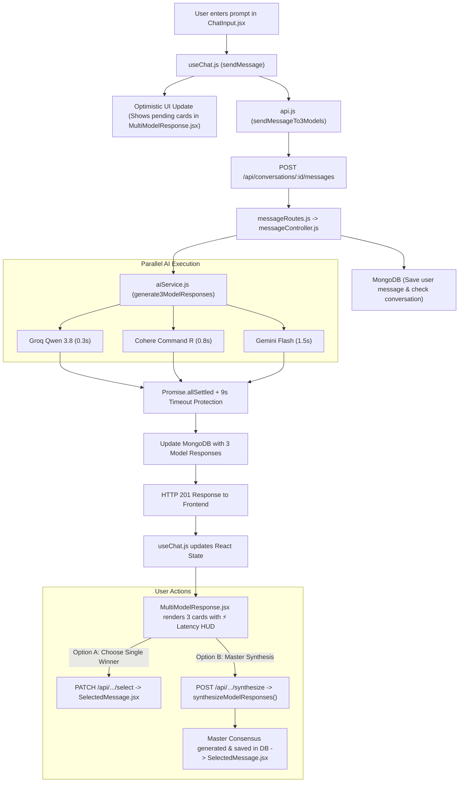

# 📘 OmniChat: Complete Architectural & Technical Documentation

> **Project Name**: OmniChat (Snitch)  
> **Repository**: [https://github.com/Suraj-web-dev/Omnichat](https://github.com/Suraj-web-dev/Omnichat)  
> **Tech Stack**: React 19, Vite, Tailwind CSS v4, Express.js, MongoDB, Groq, Cohere, Google Gemini  
> **Design Theme**: Minimalist Monochrome (Black `#09090b` & Zinc)

---

## 1. 🛠️ Tech Stack & Dependencies Overview

### Frontend
- **React 19 (`react`, `react-dom`)**: Modern React with hooks (`useState`, `useEffect`, `useRef`).
- **Vite 8 (`vite`, `@vitejs/plugin-react`)**: Ultra-fast next-gen bundler with Hot Module Replacement (HMR).
- **Tailwind CSS v4 (`@tailwindcss/vite`, `tailwindcss`)**: High-performance CSS framework configured in neutral monochrome zinc/black.
- **Lucide React (`lucide-react`)**: Clean featherweight icons (`Sparkles`, `Zap`, `Trophy`, `PanelLeftClose`, `Rows3`, `Columns3`, etc.).
- **Canvas Confetti (`canvas-confetti`)**: Metallic confetti particles triggered on selecting or synthesizing model answers.

### Backend
- **Node.js (ES Modules `type: "module"`)**: Native ESM imports throughout the backend.
- **Express 5 (`express`)**: REST API server handling conversations, messaging, and multi-model routing.
- **CORS (`cors`)**: Cross-Origin Resource Sharing middleware enabling frontend communication.
- **Mongoose 9 (`mongoose`)**: MongoDB Object Data Modeling (ODM) with automatic in-memory fallback.
- **Dotenv (`dotenv`)**: Secure environment variable configuration.

### AI Integration (100% Free Tiers)
- **`groq-sdk`**: Groq Cloud running `qwen/qwen3.8-27b` with ultra-low latency (~0.3s - 0.5s).
- **`cohere-ai`**: Cohere API running `command-r-08-2024` for structured reasoning and prose (~0.8s).
- **`@google/generative-ai`**: Google AI Studio running `gemini-flash-latest` for deep reasoning.
- **Meta-Synthesis Engine**: AI meta-prompting system merging all 3 outputs into a definitive Master Answer.

---

## 2. 🌊 Complete Code Flow (Kaha se Kaha tak data jaa raha hai)



### Detailed Lifecycle Steps:
1. **Prompt Entry**: User types prompt into `ChatInput.jsx`. Auto-resizing textarea expands as they type. Pressing `Enter` triggers `handleSubmit()`.
2. **Optimistic Frontend State**: `sendMessage()` in `useChat.js` creates a unique message ID (`generateId()`) and immediately renders placeholder loading skeletons in `MultiModelResponse.jsx`.
3. **API Dispatch**: `src/services/api.js` fires a `POST` request to `http://localhost:5000/api/conversations/:id/messages`.
4. **Backend Controller**: `messageController.js` creates or finds the conversation document in MongoDB.
5. **Parallel AI Dispatch**: `aiService.js` dispatches `Promise.allSettled` to:
   - Groq API (`qwen/qwen3.8-27b`)
   - Cohere API (`command-r-08-2024`)
   - Google Gemini API (`gemini-flash-latest`)  
   *(Each request is wrapped in an 9-second timeout safeguard to ensure zero hangs).*
6. **MongoDB Persistence**: The 3 responses are mapped into the `Message` subdocument under `models` and saved to MongoDB.
7. **Client Reception**: The frontend updates the conversation state, replaces the loading skeletons with the real model texts, latency metrics (`⚡ 0.3s`), and token counts.
8. **Selection or Synthesis**:
   - **Clicking "Choose this Answer"**: Fires `PATCH /api/conversations/:id/messages/:messageId/select`. The message collapses into `SelectedMessage.jsx` with confetti.
   - **Clicking "✨ Synthesize Master Answer"**: Fires `POST /api/conversations/:id/messages/:messageId/synthesize`. The backend feeds all three responses into the Meta-Synthesis engine, generates a consensus master answer, saves it to DB with `selectedModelId = 'synthesized'`, and displays it in `SelectedMessage.jsx`.

---

## 3. 📂 File-by-File Breakdown & Responsibilities

### 🖥️ Backend Files (`server/`)

| File Path | Core Role | Major Functions & Purpose |
| :--- | :--- | :--- |
| `server/index.js` | Express Server Entrypoint | Configures CORS, JSON parsing, health check route (`/api/health`), mounts conversation & message routes, connects to MongoDB. |
| `server/config/db.js` | Database Connector | `connectDB()`: Connects to MongoDB via Mongoose. If MongoDB is offline, gracefully switches to In-Memory fallback mode without crashing. |
| `server/models/Conversation.js` | Mongoose Conversation Schema | Schema definition for conversations: `id`, `title`, `createdAt`, `updatedAt`, and embedded array of `messages`. Transforms Mongoose Map to plain JSON object. |
| `server/models/Message.js` | Mongoose Message Schema | Schema for individual messages: `id`, `sender` ('user' or 'assistant'), `text`, `selectedModelId`, and `models` Map containing responses from Groq, Cohere, Gemini, and Synthesized. |
| `server/routes/conversationRoutes.js` | Conversation Router | Express routes for `/api/conversations`: GET list, POST create, GET single, PATCH rename, DELETE conversation. |
| `server/routes/messageRoutes.js` | Message Router | Express routes for `/api/conversations/:id/messages`: POST send prompt, PATCH select winner, POST synthesize models, GET history. |
| `server/controllers/conversationController.js` | Conversation Controller | Contains `getConversations`, `createConversation`, `getConversationById`, `renameConversation`, `deleteConversation`. Handles both live MongoDB and in-memory fallback. |
| `server/controllers/messageController.js` | Messaging & Dispatch Controller | • `sendMessageAndGenerate3Models`: Coordinates parallel AI dispatch and MongoDB saving.<br>• `selectWinningModel`: Saves chosen model ID.<br>• `synthesizeAndSelectWinner`: Gathers the 3 model texts, calls synthesis service, saves master answer to DB. |
| `server/services/aiService.js` | AI Provider Gateway & Synthesis Engine | • `callModelA_GroqOrOpenAI`: Calls Groq Cloud (`qwen/qwen3.8-27b`).<br>• `callModelB_Cohere`: Calls Cohere (`command-r-08-2024`).<br>• `callModelC_Gemini`: Calls Google Gemini (`gemini-flash-latest`).<br>• `withTimeout`: 9s timeout wrapper to avoid freezing.<br>• `synthesizeModelResponses`: Merges all 3 responses into an authoritative Master Answer. |

---

### 🎨 Frontend Files (`src/`)

| File Path | Core Role | Major Functions & Purpose |
| :--- | :--- | :--- |
| `src/main.jsx` | React Root Mounting | Mounts the `<App />` component into `#root` in `index.html`. |
| `src/App.jsx` | Master Layout Container | Houses the `useChat()` hook, manages `layoutMode` ('grid' \| 'stacked') and `sidebarOpen` state. Renders `Sidebar`, `ChatHeader`, message scroll area, and `ChatInput`. |
| `src/index.css` | Styling & Tailwind Theme | Imports `@import "tailwindcss";` and custom dark scrollbars. |
| `src/hooks/useChat.js` | Chat State Management Engine | The central brain of the frontend: manages `conversations`, `activeChatId`, `isGenerating`, `synthesizingMessageId`, syncing with backend `/api` and fallback to `localStorage`. Exposes `sendMessage`, `selectModelResponse`, `unselectModelResponse`, `synthesizeModelAnswers`, and CRUD helpers. |
| `src/services/api.js` | Frontend HTTP Client | Wrapper functions over `fetch` to talk to Express backend: `checkBackendHealth`, `fetchConversations`, `createConversation`, `sendMessageTo3Models`, `selectWinnerModel`, `synthesizeModelResponses`. |
| `src/utils/helpers.js` | Utility Helpers | • `fireConfetti`: Metallic/silver particle celebration.<br>• `copyToClipboard`: Safe clipboard copy.<br>• `formatTime`: Clean timestamp formatter.<br>• `generateId`: Unique collision-resistant string ID generator. |
| `src/data/dummyData.js` | Mock Data & Models Config | Defines `AVAILABLE_MODELS` (metadata for Groq, Cohere, Gemini), `SYNTHESIS_MODEL_INFO`, starter sample prompts (`QUICK_PROMPTS`), and dynamic fallback generator. |

---

### 🧩 UI Components (`src/components/`)

| Component | Responsibility |
| :--- | :--- |
| `ChatHeader.jsx` | Minimalist top bar displaying conversation title, sidebar open/close toggle (`PanelLeftClose`/`PanelLeftOpen`), and horizontal/vertical layout toggle (`Columns3`/`Rows3`). |
| `Sidebar.jsx` | Collapsible sidebar with New Chat button, search input, conversation session list with inline rename and delete, and active models status. |
| `ChatInput.jsx` | Multi-line auto-expanding prompt input box with keyboard shortcuts (`Enter` to submit, `Shift+Enter` for newline) and model broadcast indicator. |
| `EmptyState.jsx` | Displayed when a conversation is brand new. Shows intro cards for Groq, Cohere, and Gemini, plus one-click starter prompt chips. |
| `UserMessage.jsx` | Clean monochrome speech bubble rendering the user's inquiry and timestamp on the right side. |
| `MultiModelResponse.jsx` | **The Core Comparison View**: Displays 3 cards side-by-side (grid) or tabs (stacked), latency HUD (`⚡ 0.3s • tokens`), "Choose this Answer" buttons, and the **AI Consensus & Master Synthesis Banner**. |
| `SelectedMessage.jsx` | Renders the locked-in answer once a model (or Synthesis) is chosen. Features an expandable drawer to inspect the other 2 (or 3) raw model responses anytime. |
| `MarkdownRenderer.jsx` | Custom lightweight Markdown parser with syntax highlighting, styled tables, lists, blockquotes, and one-click code copy button. |

---

## 4. 🔑 Environment Variables Reference (`.env`)

```ini
PORT=5000
MONGODB_URI=mongodb://localhost:27017/omnichat

# 1. Google Gemini (Free Tier from https://aistudio.google.com/app/apikey)
GEMINI_API_KEY=your_gemini_api_key
GEMINI_MODEL=gemini-flash-latest

# 2. Cohere AI (Free Tier from https://dashboard.cohere.com/api-keys)
COHERE_API_KEY=your_cohere_api_key
COHERE_MODEL=command-r-08-2024

# 3. Groq Cloud (Free Tier from https://console.groq.com/keys)
GROQ_API_KEY=your_groq_api_key
GROQ_MODEL=qwen/qwen3.8-27b
```

---

## 5. 🛡️ Resiliency & Fallback Strategy

1. **MongoDB Offline?** Automatically switches to in-memory state; frontend also syncs to browser `localStorage`.
2. **Backend Server Down?** Frontend uses client-side simulated responses from `dummyData.js` so development never breaks.
3. **An AI Provider Times Out?** Every model has an independent `withTimeout(..., 9000)` safeguard. If Gemini is slow, Groq and Cohere still render instantly and Gemini gracefully falls back.
4. **Groq Free Token Limits?** `max_tokens` is configured at 850 (under the 1000 OTPM ceiling) to prevent 429 rate limit errors.
